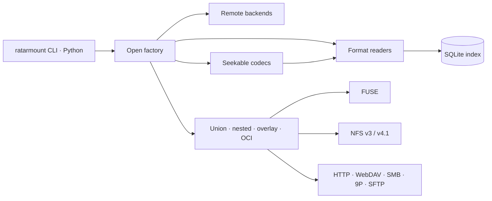

<div align="center">

# ratarmount-rs

### Mount archives, disk images, model files and remote datasets as a filesystem. Instantly.

**Browse without extracting. Read any file with true random access. Use about 20 MiB of RAM.**

<br/>

[](https://github.com/hilather/ratarmount-rs/actions/workflows/ci.yml)
[](https://github.com/hilather/ratarmount-rs/releases)
[](LICENSE)
[](https://www.rust-lang.org)
[](docs/macos.md)

<br/>

```bash
ratarmount archive.tar.gz mnt/                                                # a local archive
ratarmount -r hf://datasets/RealMattbrewer/oxford-iiit-pet-webdataset pets/   # a Hugging Face dataset
ls pets/train/train-000000.tar/ | head                                        # shards open as folders
```

</div>

---

## What it does

ratarmount-rs turns the files you already have into a directory you can read.
Point it at a TAR, ZIP, 7z, SquashFS image, disk image, Git repository, OCI
container image or a safetensors checkpoint, and every member becomes an
ordinary file. Nothing is extracted. Reads go straight to the bytes you ask
for, even inside gzip, bzip2, xz, zstd and lz4 streams, because a small SQLite
index built once remembers where everything is.

The same works for data that is not on your disk. Mount a Hugging Face
repository, a BitTorrent magnet link, an HTTP folder, an S3 bucket or an SSH
host, and only the ranges you read are fetched.

It is a native Rust rewrite of [ratarmount](https://github.com/mxmlnkn/ratarmount)
with the same index format, so indexes made by either tool work in the other.
Cold mounts are about five times faster than the Python original and a mount
holds about 20 MiB of memory, which is what makes hundreds of simultaneous
mounts practical.

- **Read** 30+ archive, image and model formats through FUSE, NFS, SMB, HTTP, WebDAV, 9P or SFTP, or from Python without any mount.
- **Write** on top with an overlay and commit the result back into the archive, with quotas and protected paths for untrusted code.
- **Share** indexes next to the archive so everyone who mounts it later skips the scan.

---

## Built for local AI

Model and dataset work means large immutable files that many processes want to
read at once. That is the case ratarmount-rs is tuned for.

### Datasets straight from the Hub

```bash
ratarmount -r hf://datasets/RealMattbrewer/oxford-iiit-pet-webdataset pets/
cat pets/train/train-000000.tar/Abyssinian_1.json
```

The repository mounts in a fraction of a second, pinned to one commit. Each
WebDataset shard opens as a folder on first access using the index published
next to it, so no shard is ever scanned, and every file read is one HTTP range
request. On a laptop with empty caches the repository mounts in 0.16 s and a
128 MiB shard opens in 1.5 s; scanning that shard instead takes 17 s.
Publish an index for your own dataset once with
`ratarmount --publish-index hf://datasets/you/name@main/shard.tar` and every
downloader gets the same zero-scan mount.
[Hugging Face guide](docs/remote-hf.md) · [publish an index](docs/recipes/publish-hf-index.md) · [the demo dataset](https://huggingface.co/datasets/RealMattbrewer/oxford-iiit-pet-webdataset)

### Models without the download

```bash
ratarmount hf://Qwen/Qwen3.8-27B@main model/        # weights fetched lazily, pinned to one commit
ratarmount -r hf://Qwen/Qwen3.8-27B@main model/     # with -r, each .safetensors file opens as a folder of tensors
```

A `hf://` mount serves model files to vLLM, llama.cpp or your own loader while
fetching only the bytes they read, with a persistent range cache and optional
sharing of the standard `huggingface_hub` cache so the same blob is never
downloaded twice. Safetensors and GGUF files mount as directories where each
tensor is a file, so you can inspect a checkpoint without loading it.
[Local models recipe](docs/recipes/local-models.md) · [tensor formats](docs/formats-tensors.md) · [offline `hf-cache://`](docs/remote-hf.md#offline-snapshots-hf-cache)

### BitTorrent and Pirate Face

```bash
ratarmount 'magnet:?xt=urn:btih:<infohash>&ws=<web-seed-url>' model/
ratarmount --torrent-swarm lan ./model.torrent model/    # share between your own machines only
```

[Pirate Face](https://pirateface.co/how-it-works) mirrors hundreds of thousands
of permissively licensed Hugging Face models and datasets as magnet links that
can carry a Hugging Face web seed. ratarmount mounts the torrent's file tree
immediately and fetches pieces on read: web seeds first, so a mount works with
zero peers, and the swarm only when a seed fails. Every piece is checked against
the torrent hash, and whole files against the Hub's SHA-256 when it is known.
On a LAN, one machine can seed a large model to the next without touching the
internet, and nothing is uploaded to the public swarm unless you pass `--seed`.
BitTorrent is on in the release packages; cargo builds need `--features bittorrent`.
[BitTorrent guide](docs/remote-bittorrent.md)

### Agent sandboxes from one snapshot

```bash
ratarmount --git-ref <base-commit> --git-synthetic-head -w attempt-07 \
  --overlay-readonly 'tests/**' --overlay-quota 2G repo.git mnt/attempt-07
```

Mount a repository at a commit once, give every agent attempt its own write
overlay, protect the test suite, cap how much an attempt may write, and throw
the attempt away by deleting a directory. The supervisor
(`ratarmount sandbox`) manages hundreds of attempts at a time and exports each
attempt's patch. On this laptop, 64 parallel attempts cost 5.2 s each to set
up and tear down, against 7.7 s for `git worktree` and 8.1 s for `docker cp`.
[Sandbox guide](docs/sandbox.md) · [SWE-bench recipe](docs/recipes/swe-bench-sandboxes.md) · [rootfs + repository](docs/recipes/sandbox-rootfs.md)

### Shards for training

```bash
ratarmount shard ./dataset -o ./shards --size 1G --group-by-key --frame-per-sample -j 4
ratarmount export-index ./shards/shards.json --format parquet -o members.parquet
```

`shard` packs a directory into reproducible WebDataset-style TAR shards, keeps
each sample's files together, makes every sample its own zstd frame, and writes
an index plus a `shards.json` manifest. Train from them with the Python
library, a FUSE mount, or any WebDataset reader.
[Shards guide](docs/shards.md) · [WebDataset recipe](docs/recipes/webdataset-shards.md) · [teacher logits](docs/recipes/teacher-logits.md)

### Python, no FUSE required

```python
import ratarmount_rs
from ratarmount_rs.webdataset import samples

shard = ratarmount_rs.open("hf://datasets/RealMattbrewer/oxford-iiit-pet-webdataset/train/train-000000.tar")
jpeg = shard.read("/Abyssinian_1.jpg")                 # one range request, no scan
for sample in samples(["shard-0.tar.zst", "shard-1.tar.zst"], shuffle=True, seed=42):
    sample["jpg"], sample["json"]
```

The `ratarmount_rs` package reads members, maps uncompressed members with
zero copies, iterates samples, plugs into PyTorch `DataLoader`, and registers
the `ratar://` fsspec protocol, so `pandas`, `pyarrow` and 🤗 `datasets` can read
inside archives. Mounting from Python is one call when the CLI is installed.
Wheels build in CI; publication to PyPI is pending.
[Python guide](docs/python.md)

### Checkpoints, traces and provenance

```bash
ratarmount -w ./overlay --commit-overlay-interval 5s --roll-every 20G traces.tar.zst mnt/
setfattr -n user.train_ok -v false mnt/trace-0042.jsonl
```

Write checkpoints and traces into a mounted archive. Settled files are
committed into seekable `.tar.zst` while the mount is live, large series roll
into numbered archives, and `user.*` attributes travel with the files into the
archive where `ratarmount find --xattr` can query them.
[Checkpoint recipe](docs/recipes/checkpoint-archives.md) · [provenance](docs/provenance.md) · [rolling archives](docs/rolling-archives.md)

**Hardware notes:** [DGX Spark and GB10](docs/local-ai/dgx-spark.md) · [NVMe placement](docs/local-ai/nvme-placement.md) · [Apple silicon and VMs](docs/local-ai/apple-silicon.md) · [two boxes over NFS](docs/local-ai/two-box-nfs.md). Everything in this section starts from the [Local AI guide](docs/local-ai/index.md).

---

## Install

Prebuilt, cosign-signed packages are on the
[Releases page](https://github.com/hilather/ratarmount-rs/releases): Ubuntu
`.deb`, Rocky `.rpm`, portable Linux tarballs (glibc 2.31) and a macOS arm64
tarball. Packages follow tags, so a feature documented here may be newer than
the latest release; `ratarmount --print-features` shows what your build has,
and `main` builds from source in a few minutes.

```bash
# Portable Linux tarball (x86_64 or aarch64)
tar xf ratarmount-*-portable-glibc2.31-x86_64.tar.gz
install -m 755 ratarmount ~/.local/bin/

# Ubuntu / Debian                      # Rocky / RHEL
sudo apt install ./ratarmount_*.deb    # sudo dnf install ./ratarmount-*.rpm

# macOS (Apple silicon): tarball, or the Homebrew tap cask
brew install --cask macfuse            # or fuse-t
tar xf ratarmount-*-macos-arm64.tar.gz && install -m 755 ratarmount-*/ratarmount ~/.local/bin/
```

**From source** (Rust 1.90+, FUSE 3, libarchive and zlib headers):

```bash
make release && make install                      # → ~/.local/bin/ratarmount
cargo build --release -p ratarmount --features nfsv4,sftp-russh,bittorrent   # what the packages ship
```

Workspace MSRV is 1.90. On Linux, mounts that other users or containers must
see need `user_allow_other` in `/etc/fuse.conf`. Details, verification and
package layout: [packaging](docs/packaging.md) · [macOS](docs/macos.md).

---

## Quick start

```bash
ratarmount archive.tar.gz mnt/            # mount (daemonizes; -f stays in the foreground)
ratarmount -u mnt/                        # unmount

ratarmount -r archive.zip mnt/            # nested archives open as folders, without temp files
ratarmount -r -l huge.deb mnt/            # lazy: open nested archives on first access

ratarmount -w ./changes archive.tar mnt/  # write on top of a read-only archive
ratarmount --commit-overlay -w ./changes archive.tar   # fold the changes back in

ratarmount s3://bucket/data.tar.zst mnt/  # remote archives: http(s), s3, gs, az, ssh, hf, magnet, ...
ratarmount docker://ubuntu:24.04 mnt/     # a container image as a directory tree

ratarmount find '*.json' archive.tar      # locate members without mounting
ratarmount --nfs archive.tar.gz           # serve over NFS instead of (or as well as) FUSE
ratarmount --repack-seekable big.tar.gz big.tar.zst   # make a gzip archive randomly accessible
```

The full command tour, with explanations and the useful flags for each
scenario, is in [Getting started](docs/getting-started.md).

---

## What you can mount

| Group | Formats |
|---|---|
| **Archives** | TAR (ustar, PAX, GNU, sparse, incremental) · ZIP (store and deflate, passwords, multi-part) · 7z (AES, BCJ2, solid) · CPIO · AR · XAR · CAB · ASAR · WARC · SQLAR · split `.001` parts · lrzip · RAR, LHA and the long tail through libarchive |
| **Compressed streams** | Random access inside gzip · bzip2 · xz · zstd (multi-frame and seek table) · lz4 · lzip · lzo · compress `.Z` · lzma · zlib |
| **Disk images and filesystems** | ISO 9660 · UDF · SquashFS · EXT2/3/4 · FAT · exFAT · NTFS (read-only) · GPT/MBR partitioned images · DMG · WIM · QCOW2 · VHD/VHDX · VMDK |
| **AI and data** | safetensors · GGUF · WebDataset shards · Parquet, JSONL and images as plain lazy files from any remote |
| **Code, containers, backups** | Git repositories at any commit, including history-free snapshots · OCI and Docker images as a layer union · restic repositories |
| **Documents** | PDF attachments and images · OGG · HTML |

Nested archives open from the parent stream without copying to `/tmp` for
almost every format, so `-r` on a TAR of ZIPs of TARs stays cheap.
Per-format details, random-access behaviour, write support, known limits and
measured numbers: [Supported formats](docs/formats.md).

### Remote sources

| Scheme | Source |
|---|---|
| `hf://`, `hf-cache://` | Hugging Face Hub repositories pinned to a commit; the local Hub cache offline |
| `magnet:`, `.torrent` | BitTorrent with web seeds first and verified pieces (release packages) |
| `http(s)://` | Range requests, Basic, Cookie and Bearer auth, autoindex folders |
| `s3://`, `gs://`, `az://` | Object stores with folder listings and index publishing |
| `ssh://`, `sftp://`, `ftp(s)://`, `webdav(s)://`, `smb://`, `dropbox://` | File servers and shares |
| `oci://`, `docker://`, `ghcr://` | Container images from any registry |
| `ipfs://`, `ipns://`, `rclone://`, `rclone+remote:` | Gateways and anything rclone can reach |
| `restic:/path` | Local restic repositories as a snapshot browser |

On HTTP, object stores, the Hub and torrents, an index published next to the
archive (`{url}.index.ptr` plus `{url}.index.<sha256>.sqlite`) is discovered
automatically, and fetched ranges persist in a local cache.
[Remote sources](docs/phase10-remote.md) · [caches](docs/caches.md)

---

## Write, sandbox, serve

**Write overlays.** `-w DIR` makes any mount writable. Changes live in the
overlay until you commit them: offline into gzip, bzip2, xz TAR and ZIP, or
live while the mount is served for uncompressed TAR and `.tar.zst`, where only
the last zstd frame is rewritten. `--overlay-readonly`, `--overlay-quota` and
`--sandbox` turn an overlay into a guard rail for untrusted code.
[Writing into archives](docs/write-overlay.md) · [sandbox controls](docs/sandbox.md)

**Network exports.** One process can serve the same tree over NFSv3 or
NFSv4.1 (`--nfs`), HTTP (`--http`), WebDAV (`--webdav`), SMB 3.1.1 (`--smb`),
9P (`--ninep`) and SFTP (`--sftp`), with overlay writes where the protocol
allows. Kubernetes gets an in-tree CSI node driver, Docker and Podman a volume
plugin, and HPC hosts a `mount.fuse.ratarmount` helper for fstab, systemd and
autofs. [NFS](docs/nfs-export.md) · [other exports](docs/export.md) · [CSI](docs/csi.md) · [volume plugin](docs/docker-volume-plugin.md) · [systemd](docs/systemd-mount.md)

**Tuning.** `--memory-budget` caps the daemon's own pools, `--direct-io` keeps
one-pass training reads out of the page cache, `--readahead` widens sequential
windows, and on Linux 6.9+ a privileged mount can hand eligible files to the
kernel with FUSE passthrough.
[FUSE tuning](docs/fuse-kernel-tuning.md) · [memory budget](docs/memory-budget.md)

---

## Performance

All numbers come from committed benchmark runs you can repeat; see
[Benchmarks](docs/benchmarks.md) for the full tables, methodology and caveats.
They are single-host measurements, not guarantees.

**Against Python ratarmount 1.3.0** (geometric mean over 16 archives, v0.1.27, 2026-08-27):

| | Cold | Warm |
|---|---:|---:|
| Mount time | **5.2× faster** | **6.8× faster** |
| Peak memory | **4.3× lower** | **6.5× lower** |
| Random 64 KiB read | **7.7× faster** | **8.7× faster** |
| Sequential read | **3.9× faster** | **3.2× faster** |

The biggest wins are on large `.tar.zst` and `.tar.lz4` archives, where
random reads run tens of times faster. Python still wins small `.tar.gz` reads
and the cold mount of one 640 MiB `.tar.zst`.

**Local AI workloads** (a six-core laptop, release build, October 2026):

| Workload | Result |
|---|---|
| WebDataset samples/s, 8 workers | extracted files 4,249 · Python library 2,509 · FUSE mount 2,233 · `webdataset` on plain TAR 1,430 |
| Agent sandbox, 64 parallel attempts | ratarmount 5.2 s per attempt · `git worktree` 7.7 s · `docker cp` 8.1 s |
| Build and test zlib inside a sandbox | 3.1 s against 2.5 s on the host |
| Cold open of three shards | 0.086 s scanning · 0.016 s with published indexes |
| 32 concurrent mounts | 679 MiB resident in total, about 21 MiB each |
| Small model, first tensor read | `hf download` then load 1.35 s · `hf://` mount plus first read 0.35 s · second read 5 ms |
| 256 MiB zstd member, 4 decode threads | library 2.8 GB/s · FUSE 1.3 GB/s · `zstd -d` 1.6 GB/s |

Per-format mount and read numbers for every archive type live in
[Supported formats](docs/formats.md#measured).

---

## How it works



Every format is a `MountSource`: it lists members and serves byte ranges.
Compressed streams get a seek map so a member read decodes only the block or
frame that covers it. The SQLite index stores member offsets and the seek maps,
and is the same 0.7.x schema as Python ratarmount. Compositing layers stack
unions, nested archives, overlays and container whiteouts on top, and the
front ends (FUSE, the network exports and the Python library) all share one
in-process `Session`.

| Crate | Role |
|---|---|
| `ratarmount` | The CLI |
| `ratarmount-session` | In-process Session API for embedders, no FUSE ([guide](docs/session-api.md)) |
| `ratarmount-python` | The `ratarmount_rs` Python package |
| `ratarmount-core`, `ratarmount-index`, `ratarmount-compress` | `MountSource` trait, SQLite index, seekable codecs |
| `ratarmount-formats-*` | One crate per format family |
| `ratarmount-compositing` | Union, nested automount, write overlay, OCI layers |
| `ratarmount-remote` | Hugging Face, BitTorrent, HTTP, S3, GCS, Azure, SSH, OCI and the rest |
| `ratarmount-fuse`, `ratarmount-nfs`, `ratarmount-http`, `ratarmount-smb`, `ratarmount-9p`, `ratarmount-sftp` | Front ends |
| `ratarmount-csi`, `ratarmount-volume-plugin` | Kubernetes CSI node driver and Docker volume plugin |

Embedders should depend on `ratarmount-session`, never on the binary crate.

---

## Known limits

The honest list, with what is planned, is in [Supported formats](docs/formats.md#known-limits)
and the [parity checklist](docs/parity-todo.md). The short version:

- Gzip throughput is below Python's rapidgzip on small `.tar.gz` files; `--repack-seekable` or multi-frame zstd is the fix for archives you own.
- Some formats are read-only or partial: NTFS compression, HFS+/APFS inside DMG, WIM LZX, QCOW2 zstd clusters, differencing VHD, ESXi VMDK, classic SquashFS LZMA, pure RAR.
- Writes commit TAR variants and ZIP; live commits cover uncompressed TAR and `.tar.zst` only, and ZIP commits rebuild the archive.
- NFS has no Kerberos; SMB has no Kerberos or DFS; exports bind to localhost unless you say otherwise.
- macOS is first-class on Apple silicon only; the CLI does not build for Windows (the core library crates do).
- BitTorrent v2-only swarms and seeding to the public internet are limited or opt-in; see the [BitTorrent guide](docs/remote-bittorrent.md).

Upstream feature requests we track: [docs/tasks/upstream-feature-requests.md](docs/tasks/upstream-feature-requests.md).

---

## Documentation

Start at the [documentation index](docs/README.md). Most-read pages:

| | |
|---|---|
| [Getting started](docs/getting-started.md) | Every common command, explained |
| [Local AI guide](docs/local-ai/index.md) | Datasets, models, sandboxes, shards, Python, hardware notes |
| [Supported formats](docs/formats.md) | Every format, what works, what does not, measured numbers |
| [Hugging Face](docs/remote-hf.md) · [BitTorrent](docs/remote-bittorrent.md) · [other remotes](docs/phase10-remote.md) | Remote sources |
| [Python library](docs/python.md) | `ratarmount_rs`, fsspec, PyTorch, WebDataset |
| [Writing into archives](docs/write-overlay.md) · [sandboxes](docs/sandbox.md) | Overlays, commits, quotas |
| [NFS](docs/nfs-export.md) · [other exports](docs/export.md) · [systemd](docs/systemd-mount.md) · [CSI](docs/csi.md) | Serving and deployment |
| [Benchmarks](docs/benchmarks.md) | All measured results and how to reproduce them |
| [Session API](docs/session-api.md) | Embedding the engine in your own program |

---

## Development

```bash
cargo fmt --all
cargo clippy --workspace --all-targets -- -D warnings
cargo test --workspace
./test-harness/run-all-phases.sh    # FUSE phase allowlists (or: make suite)
```

CI runs formatting, clippy and tests first, then the FUSE allowlists,
cold-index benchmark gates, an MSRV job and a macOS build. Contributors and
agents follow [AGENTS.md](AGENTS.md): every fix ships with a regression test,
and user-visible changes update the docs in the same commit. Releases are
described in [packaging](docs/packaging.md).

---

## Related

- The Python original: [mxmlnkn/ratarmount](https://github.com/mxmlnkn/ratarmount)
- Releases: [hilather/ratarmount-rs/releases](https://github.com/hilather/ratarmount-rs/releases)
- Demo dataset with published indexes: [RealMattbrewer/oxford-iiit-pet-webdataset](https://huggingface.co/datasets/RealMattbrewer/oxford-iiit-pet-webdataset)

## License

[MIT](LICENSE), aligned with upstream ratarmount.

<div align="center">

<sub>Built for people who open multi-GB archives more often than they extract them.</sub>

</div>
